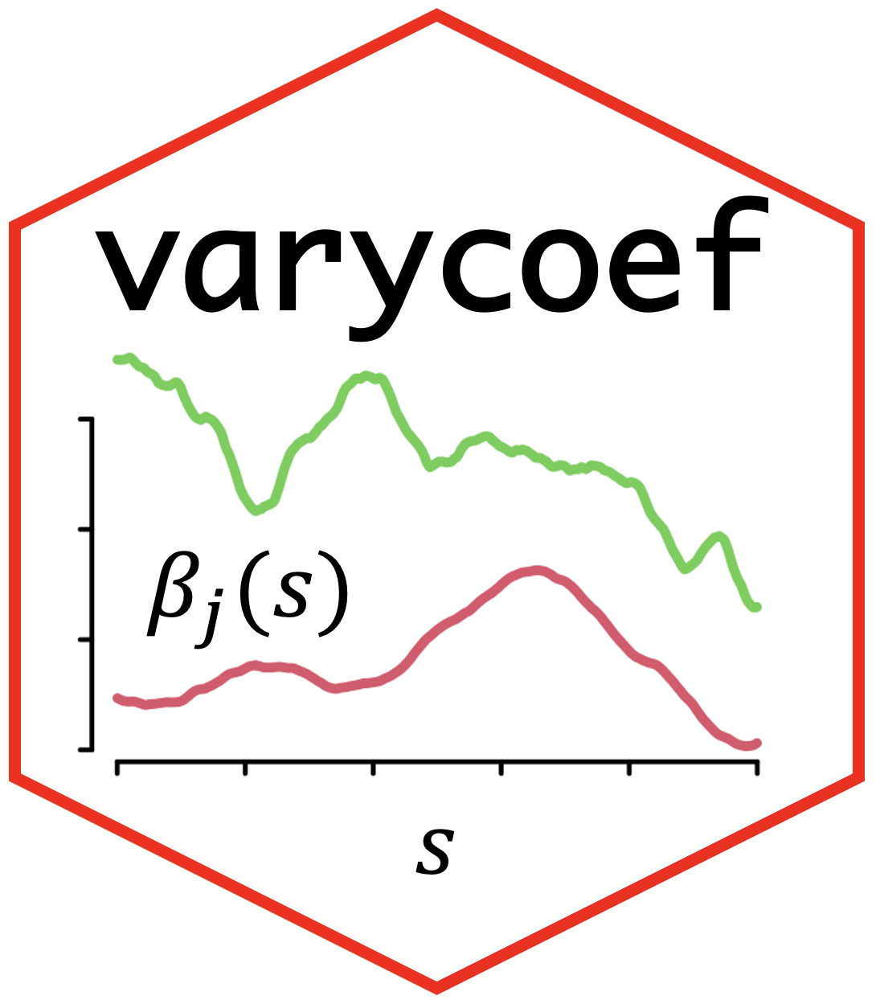

<p align="right">
  
</p>

# varycoef

**Model spatially varying coefficients with Gaussian processes.**

[](https://CRAN.R-project.org/package=varycoef)
[](https://cranlogs.r-pkg.org/)

## About

`varycoef` fits Gaussian process-based spatially varying coefficient (SVC)
models. It extends linear regression by allowing selected coefficients to vary
over coordinates, such as geographic locations or time points. The package
provides maximum likelihood estimation, prediction of coefficients and
responses, covariance tapering for larger datasets, and joint variable
selection.

The statistical methodology is described in
[Dambon et al. (2021a)](https://doi.org/10.1016/j.spasta.2020.100470) and
[Dambon et al. (2021b)](https://doi.org/10.1080/13658816.2022.2097684).
Covariance tapering follows
[Furrer et al. (2006)](https://doi.org/10.1198/106186006X132178).

## Installation

Install the released package from CRAN:

```r
install.packages("varycoef")
```

To install the latest development version from GitHub:

```r
install.packages("remotes")
remotes::install_github("jakobdambon/varycoef", subdir = "R-pkg")
```

## Model

Let \(y\) be the response, \(X\) the fixed-effect design matrix, and \(W\) the
design matrix for coefficients that vary with location \(s\). The model is

$$
y = X\beta + W e(s) + \xi,
$$

where \(\beta\) contains the fixed effects, \(e(s)\) contains
location-dependent deviations, and \(\xi\) is independent Gaussian noise.
Each varying coefficient is modeled as a Gaussian process. Set \(W = X\) when
all coefficients vary; use a different \(W\) to select which coefficients
vary.

See the package
[Introduction vignette](https://htmlpreview.github.io/?https://github.com/jakobdambon/varycoef/blob/master/examples/01_Introduction.html)
for a worked example and model details.

## Version 0.4.0

The 0.4.0 development version focuses on more robust input validation,
improved covariance calculations, expanded regression tests, and reduced
required dependencies for model fitting. See the [0.4.0 release notes](R-pkg/NEWS.md).

The [CRAN-versus-development benchmark article](docs/index.md) describes the
comparison with CRAN 0.3.6, including the synthetic-data design, tapered and
untapered runtime results, numerical agreement, and coefficient/response
figures.

## Version history

| Version | Highlights | Release date |
|---|---|---|
| 0.4.0 | Improved validation and covariance calculations; expanded tests; lighter core dependencies. | In preparation |
| 0.3.5 | Returned to CRAN after resolving testing issues. | 26 March 2025 |
| 0.3.4 |  | 17 September 2022 |
| 0.3.3 | Removed some dependencies on `RandomFields`. | 1 June 2022 |
| 0.3.2 | Added the `parscale` option to `SVC_mle_control`. | 19 July 2021 |
| 0.3.1 | Added summary output and other methods. | 12 May 2021 |
| 0.3.0 | Added joint variable selection. | 13 January 2021 |
| 0.2.10 | Added `optimParallel` support and citation information. | 23 February 2020 |
| 0.2.9 | Final release before the package returned to CRAN. | 10 October 2019 |
| 0.2.8 | Revisions for CRAN submission. | 8 October 2019 |
| 0.2.7 | Added summary, printing, plotting, and other `SVC_mle` methods. | 16 September 2019 |
| 0.2.6 | Added predictive variance. | 5 September 2019 |
| 0.2.5 | Improved handling of multiple observations at locations. | 10 July 2019 |
| 0.2.4 | Added `SVC_mle.control` and updated the vignette. | 10 July 2019 |
| 0.2.3 | Added profile likelihood and coefficient/covariance extraction functions. | 10 July 2019 |
| 0.2.2 | Fixed multiple observations at locations; added residuals and fitted methods. | 5 June 2019 |
| 0.2.1 | Enabled covariance tapering. | 23 April 2019 |
| 0.2.0 | Separated fixed and random effects. | 12 April 2019 |

## Acknowledgements

Selected improvements and code enhancements in this package were developed with assistance from GitHub Copilot. All AI-assisted contributions were reviewed, tested, and validated by the package maintainer.
