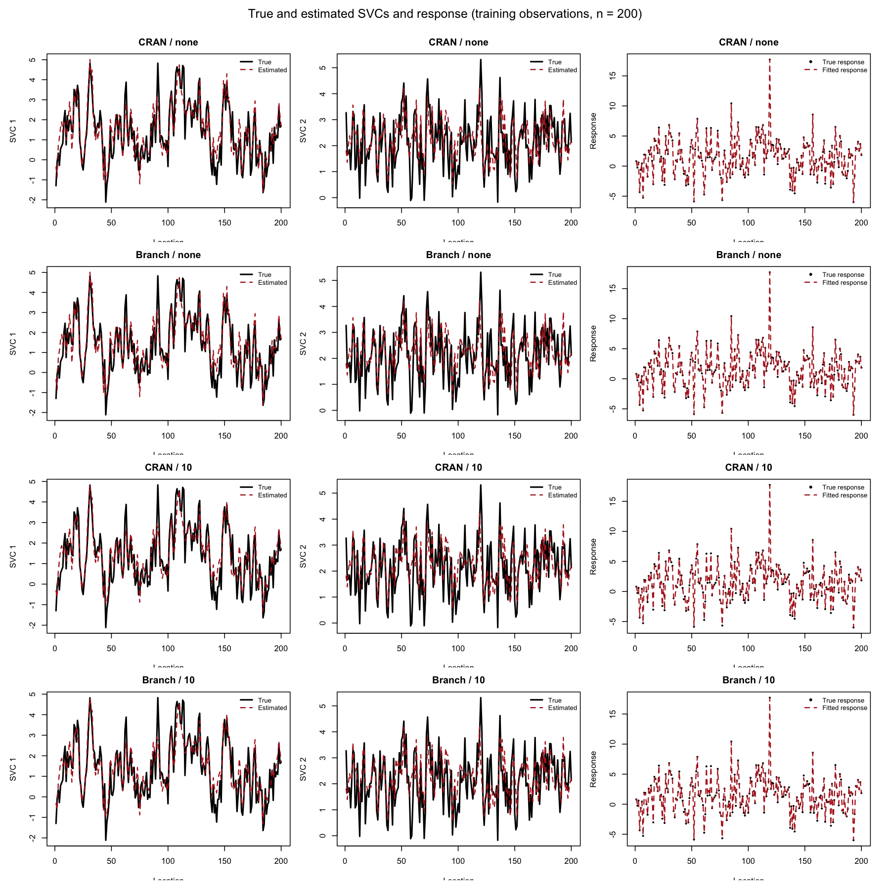
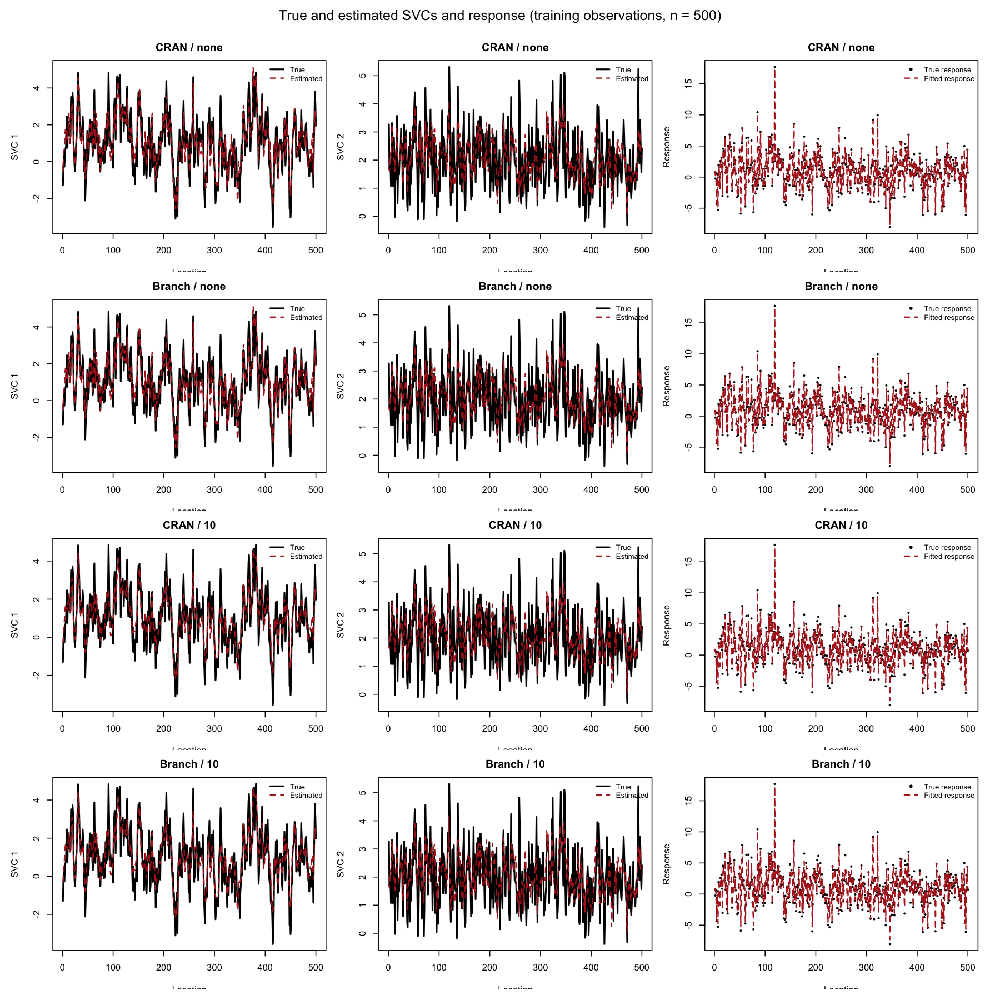
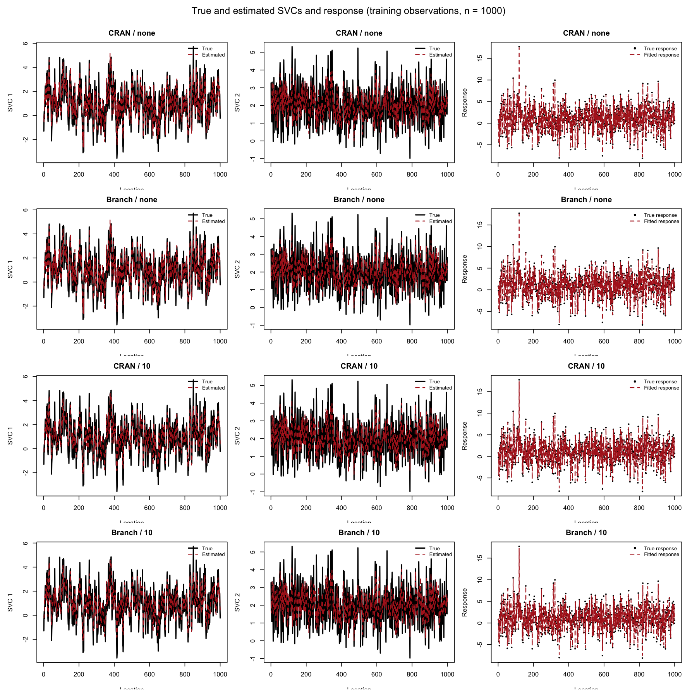

# CRAN and Development-Version Comparison

**Authors:** Jakob A. Dambon and GitHub Copilot (co-author; AI development
assistance).

This article compares the fixed CRAN release of `varycoef` (0.3.6) with the
package source prepared for the proposed 0.4.0 release. The script requests
0.3.6 explicitly and verifies the installed version. If 0.3.6 is no longer
the current CRAN version, it retrieves that release from the CRAN Archive.
This keeps the baseline fixed after 0.4.0 is published. The comparison asks
two separate questions:

1. Do both versions return numerically similar estimates on the same data?
2. How do their model-fitting runtimes compare at three training-set sizes?

This is a reproducible, synthetic-data benchmark, not a general performance
guarantee. It measures the particular model, data, hardware, and optimizer
settings described below.

### Summary

- Ten timed fits were run for each of six size/taper combinations and each
  package version (120 timed fits total).
- All six CRAN-versus-development result comparisons passed the scaled
  tolerance of `0.002`.
- The development version had a lower median runtime in all six conditions:
  **44.8%–55.4% faster without tapering** and **12.0%–13.4% faster with
  tapering** on this machine.
- The largest numerical difference was `0.001204`, below the tolerance.

These are observed benchmark results, not a guarantee of equivalent speedups
or numerical behavior for different models, datasets, or systems.

## What is compared

The benchmark run reported below used the CRAN 0.3.6 macOS binary. The
reproduction script now requests the exact 0.3.6 source release, with a version
check, so future runs continue to compare against 0.3.6 after newer releases
appear. The development package is installed from the `R-pkg` source in this
repository. Both receive the same generated observations, covariates,
locations, covariance model, and optimizer-worker count. Tapered and untapered
fits are compared separately; the tapered fit is not expected to reproduce
the untapered fit.

The package source was assigned version 0.4.0 for this benchmark. The
development changes improve validation and covariance calculations, and add
regression coverage; they do not intentionally change the statistical model
used here.

## Synthetic data

The benchmark sets the random seed to `20261105` and uses
`varycoef::sample_SVCdata()` to generate one one-dimensional dataset on
integer-spaced locations. The data-generating model has two covariates:

- The first is an intercept, and the second is a standard-normal covariate.
- Both coefficients vary spatially: the random-effects design is `W = X`.
- The two latent coefficient processes have means 1 and 2, marginal variances
  2 and 1, and exponential covariance ranges 3 and 1, respectively.
- Independent observation noise has standard deviation 0.5.

Thus, at location \(s_i\), the response is

\[
y_i = X_{i1}\beta_1(s_i) + X_{i2}\beta_2(s_i) + \epsilon_i.
\]

One sample of 1,005 observations is generated and reused for all package
versions and settings. For each requested size \(n \in \{200, 500, 1000\}\),
training uses exactly the first \(n\) observations. These are nested prefixes
of the same sampled data, not independent resamples. Predictions and the
plotted estimates are evaluated at those training locations; this benchmark
does not assess held-out prediction.

## Fitting and tapering

Each fit uses the same exponential covariance specification and profile
likelihood optimization. The model includes both the varying intercept and
varying slope. The comparison uses `optimParallel` with six optimizer workers
per fit.

The untapered runs use the full covariance matrices. The tapered runs use a
fixed range of 10 location units with the package's Wendland type 1 taper.
Because locations are spaced one unit apart, this limits nonzero tapered
covariance interactions to a local neighborhood, making the covariance
calculations sparse. The range is a fixed benchmark setting, not a value
selected from these results or a claim that 10 is optimal for other datasets.

For each package version, training size, and taper mode, the script performs
ten fits and records elapsed time around each model fit. The reported runtime
is the median of those ten measurements; package installation, data
generation, and prediction/plotting are outside the timed interval. The last
fit is used for the estimates and predictions shown in the plots. Versions are
run in alternating order by training size to reduce systematic order effects.
In total, the script executes six benchmark conditions for each version, with
ten fits per condition.

## Numerical agreement

The script compares fixed-effect coefficients, covariance parameters, fitted
values, residuals, and predicted values. For each output vector it computes the
maximum scaled componentwise difference:

\[
\max_j \frac{|a_j - c_j|}{\max(1, |c_j|)},
\]

where \(c\) is the CRAN result and \(a\) is the development result. A comparison
passes when every output's maximum scaled difference is at most \(2 \times
10^{-3}\). This tolerance is applied within each taper mode; it is not a
comparison between tapered and untapered estimates.

## Runtime and results

The [benchmark report](benchmark-results.csv) records the versions, number of
repetitions, worker count, median times, percentage speedup, numerical-match
indicator, and maximum scaled difference for every size and taper setting.
Positive speedup means the development package's median fit time was lower.

| Training n | Taper range | CRAN 0.3.6 median (s) | Development 0.4.0 median (s) | Speedup | Max scaled difference | Match |
|---:|:---|---:|---:|---:|---:|:---:|
| 200 | None | 1.321 | 0.729 | 44.8% | 1.35e-9 | Yes |
| 200 | 10 | 0.420 | 0.370 | 12.0% | 0 | Yes |
| 500 | None | 16.595 | 7.405 | 55.4% | 3.19e-5 | Yes |
| 500 | 10 | 0.560 | 0.485 | 13.4% | 0 | Yes |
| 1000 | None | 123.140 | 59.631 | 51.6% | 1.204e-3 | Yes |
| 1000 | 10 | 0.831 | 0.727 | 12.5% | 0 | Yes |

All six comparisons passed the `2e-3` tolerance, and the development version
had the lower median runtime in each condition. The largest scaled difference
was `1.204e-3` for the untapered `n = 1000` fit, still below the specified
tolerance. The measured speedups were 44.8% to 55.4% without tapering and
12.0% to 13.4% with tapering. Runtime results are specific to this benchmark
environment and should not be extrapolated to other hardware or models.

## SVC and response plots

Each figure compares the CRAN and development fits, with separate rows for
untapered and tapered models. The panels show the true and estimated values
for both spatially varying coefficients, along with the observed response and
the fitted response. Estimates and responses are restricted to the training
prefix, so plots do not imply out-of-sample performance. Coefficient estimates
include their fitted fixed-effect means.

### Training size 200



### Training size 500



### Training size 1000



## Reproducing the comparison

From the repository root, run:

```sh
Rscript docs/scripts/compare-cran-vs-branch.R --repetitions 10 --cores 6
```

By default, the script writes the CSV report to `docs/benchmark-results.csv`
and PNG figures to `docs/images/benchmark/`. It installs CRAN 0.3.6 and the
package in the current checkout into temporary libraries. If necessary, it
also installs `remotes` into a temporary library to retrieve the pinned CRAN
version. The source archive and package dependencies must be available from
the selected CRAN mirror. Parallel execution requires the optional R package
`optimParallel`; use `--cores 1` for serial optimization. See the script's
`--help` output for additional options.

## Run environment

The reported run used R 4.5.1 on macOS Sonoma 14.6.1, on an Apple M3 Pro with
11 logical CPUs. Six `optimParallel` workers were used for each fit.
